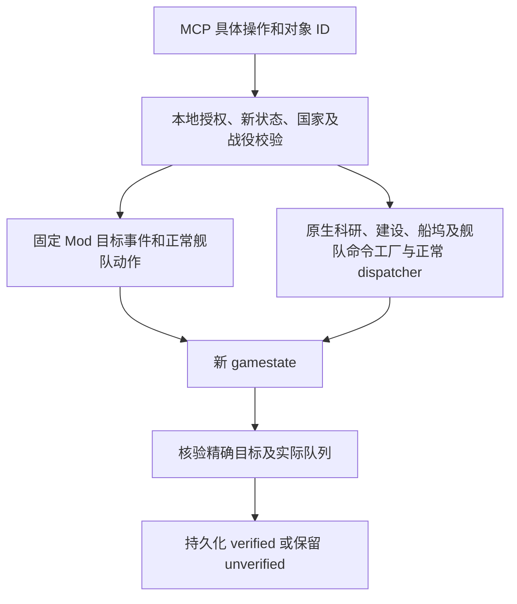

# MCP 逐项指挥

当前目标是由 MCP 指定具体对象和操作参数。桥接不会启用 `human_ai`、`playme` 或原生 AI 托管。

本机已在 **Cygnus v4.5.2 (9776)**、地球联合国 country 0、单人非铁人存档副本中完成真实 stdio MCP 测试。游戏控制没有键盘或鼠标输入。

## 已经实机通过的工具

| 工具 | 精确参数 | 已验证结果 |
| --- | --- | --- |
| `issue_order` | `{"kind":"fleet_orbit","fleet_id":"3","planet_id":"3"}` | 指定舰队的队列含指定星球的普通环绕动作和 30 天等待 |
| `issue_order` | `{"kind":"fleet_wait","fleet_id":"3","days":45}` | 指定舰队的旧脚本动作被清空，队列只剩本次等待 |
| `select_research` | `{"area":"physics","technology_id":"tech_shields_2"}` | 指定物理学科技成为未完成的当前科研 |
| `select_research` | `{"area":"society","technology_id":"tech_planetary_unification"}` | 指定社会学科技成为未完成的当前科研 |
| `select_research` | `{"area":"engineering","technology_id":"tech_mining_1"}` | 指定工程学科技成为未完成的当前科研 |
| `queue_district` | `{"planet_id":"3","district_id":"district_city"}` | 正常扣除 500 矿物，出现未完成的普通建设项目，区划等级未瞬间增加 |
| `queue_building` | `{"planet_id":"3","zone_id":"0","building_id":"building_research_lab_1"}` | 在地球分区 0 正常付费 400 矿物，出现未完成的研究实验室项目，已有建筑不变 |
| `set_paused` | `{"paused":true}` / `{"paused":false}` | 正常暂停/恢复指令，独立实时状态与游戏内条件回执同时验证 |

等待支持 1–365 整数天。环绕目前限自有、己方控制、与舰队同系统的星球；固定舰队接口支持明确可移动、未交战的军事舰队、科研船、工程船和殖民船。上表旧实测使用的具体舰队与结果保持不变；普通殖民船建造入队、普通 `colonize_planet` 命令与 `3812` landing 已由 `qs-extended-mcp-trial.json` 和 `qs-fleet-completion-resume-outpost.json` 验证；完整殖民发展仍未验证。成功订单和 landing 分开记录，不能由入队回执推断落地。

科研工具要求选择当前新状态中指定领域的可见候选、明确关闭自动科研、已完成科技列表可观察。当前原生后端仅验证 country 0。已完成或重复科技选择暂不开放。科技 ID 会在数据库中按精确 key 查找，不变成脚本或机器码。

建设工具使用普通原生命令的合法性检查、排队和付费过程。验收需要唯一新项目、正确付款国/目标/队列、正工期且未完成、原有区划/建筑不变，以及同月库存扣费与项目成本完全相符。未由窗口消息确认暂停时，day > 15 的快照会要求刷新到下月；已确认暂停时仍严格核对前后同月及实际付款。建筑分区必须出现在目标星球的新状态中，缺失建筑列表不会被猜成已知空集。

**4.5.2 的建设字段存在两个 ID 空间。** 物理星球 3 的 `colony=0`；项目中 `buildable_*.planet=0` 指向殖民地 0，队列 `location={type=2 id=3}` 指向地球本体。验证器必须同时核对项目殖民地、`colony.carrier={type=planet reference=3}`、星球的 colony/build_queue 与付款国。把项目的 3 直接等同于星球 3 是错误的。此前区划证据只能证明付款/入队，正确目标须以修正后的新试验为准。

暂停实测没有设置每日邮箱调度：暂停、连续读取新状态、选择物理科技、舰队环绕和替换等待队列全部保持在 2200.01.13；恢复后日期正常推进到 2200.01.20。执行入口是已绑定游戏线程的私有 Windows 注册消息，没有模拟键鼠。普通暂停命令不改保护来源或模式；模态/事件保护暂停可以拒绝恢复。

## 新增的精确操作接口

以下接口已经接入相同的本地授权、暂停校验、原生合法性检查、命令日志和新状态验收流程。**接口实现和单元测试不等于真实游戏验证。** 这些新增操作的实机结果应以各项实际试验报告为准；本节不把工厂分配或 `submitted` 回执写成成功。

本轮 `qs-extended-mcp-trial.json` 已通过：升级、拆除、转换、取消及退款、普通和殖民造舰入列、指定天体勘察、采矿站订单、跨系统移动和停止，均有新状态的后置条件，最终无未决命令。自然完成两阶段、哨站和殖民 landing 由 `qs-fleet-completion-trial.json` 的 `cumulative_validation` 记录：原 partial trial 仍为 `verified:false`，resume report 为 `verified:true`，不是原 trial 整体变 true；完整殖民发展仍未验证。

| 工具 | MCP 参数 | 具体含义与验收条件 |
| --- | --- | --- |
| `upgrade_building` | `planet_id`, `zone_id`, `building_id`, `target_building_id` | `building_id` 是分区内现有建筑的实例 handle，`target_building_id` 是升级后的建筑模板 key。必须出现目标明确的普通付费升级项目，源建筑暂时保留。 |
| `demolish_building` | `planet_id`, `zone_id`, `building_id` | 通过普通拆除命令移除该实例。新快照必须证明只有指定建筑从该分区消失。 |
| `convert_zone` | `planet_id`, `zone_id`, `target_zone_id` | `zone_id` 是现有分区实例，`target_zone_id` 是目标专精模板 key。排入普通付费转换项目，保留精确 district、slot 与殖民地引用。此工具不把一种区划改成另一种区划。 |
| `cancel_construction` | `planet_id`, `item_id` | 取消该星球队列中的一个明确未完成项目。必须观察到正确项目移除、队列成员一致及与记录成本对应的退款。 |
| `survey_planet` | `fleet_id`, `planet_id` | 为一支明确的科研船舰队提交对一个物理天体的勘察订单。新状态需包含可达、目标一致的新订单；整系统勘察及最终完成需另行观察。 |
| `build_station` | `fleet_id`, `planet_id`, `station_type` | 工程船建造 `mining`、`research` 或 `outpost`。目标是已勘察的物理天体，前哨站使用恒星；验证新订单的目标、站点类别及实际正常扣费。最终站点建成需另行观察。 |
| `colonize_planet` | `fleet_id`, `planet_id` | 用一支已观察到的殖民船舰队向已勘察星球提交普通殖民订单。游戏仍检查可达性、归属和殖民条件；`qs-fleet-completion-resume-outpost.json` 已验证普通命令与 `3812` landing，但完整殖民发展仍未验证。 |
| `queue_ship` | `starbase_id`, `design_id` | 在一个明确自有船坞，用本国当前的普通科研船、工程船或标准军舰设计排一艘船。必须核对星际基地→空间站→本国舰队→船坞队列，以及唯一未完成新项目、设计、星际基地和实际付费。当前使用设计的 growth stage 0；防御平台、生物舰、运输船及需要专用工厂的舰型被拒绝。 |
| `queue_colony_ship` | `starbase_id`, `design_id`, `species_id` | 用专用殖民船工厂与明确种族引用排一艘普通殖民船。船坞、殖民船设计与本国拥有的完整种族引用必须可观察；本地适配器核对当前国家实际记录的主种族殖民权利，未知的次级权利继承会阻止操作。原生命令继续检查设计合法性与正常成本。需要新项目中设计、种族和星际基地一致并实际付费。 |

这九个原生扩展要求先 `set_paused(true)` 并 `request_observation()`，建立当前连接的实际暂停状态。只有 `native_bridge.supports_wakeup == true` 且最近窗口消息返回严格布尔 `paused:true` 才允许提交。未知或整数 `1` 不能代替这个严格布尔值。

升级、拆除、转换和取消继续同时检查物理星球 ID 与殖民地 ID，不混用 ID 空间。目标实例、队列成员、费用或源建筑不可观察时，工具拒绝执行或保留未验证操作。模型没有输入脚本、价格、坐标、原生地址或文件路径的参数。

### 跨系统移动

`issue_order` 新增固定 `fleet_move` 订单：

```json
{"kind":"fleet_move","fleet_id":"1","planet_id":"104"}
```

示例 ID 仅说明格式，必须从当前 `fleets_by_id` 和 `space.planets_by_id` 选择实际对象。`planet_id` 是目的系统中一个已经观察到的物理天体，用于明确绑定该系统；工具用普通寻路移动到系统，不表示环绕该天体。目标系统必须已访问，且系统的完整天体列表与该天体的 `system_id` 一致；没有星图坐标输入。引擎检查系统通行条件，固定模板替换原订单并追加 30 天等待。新快照需包含精确目标系统的 `move_to` 与等待动作；到达另行观察。

固定版本实际将该动作保存为 `move_to={coordinate={x=0 y=0 origin=<系统ID>}}`。核验只接受这个实测的系统中心结构，拒绝非零位置、未知坐标或假设的 `target.galactic_object` 形状。坐标来自游戏序列化，不是模型输入参数。

### 清空已有订单和殖民流程

普通原生勘察、建站和殖民订单会拒绝仍带有脚本动作的舰队，因为下一次 tick 的旧脚本可能覆盖新订单。先用固定 `fleet_stop` 清理同一艘船的两个队列：

```json
{"kind":"fleet_stop","fleet_id":"1"}
```

这个订单只有 `kind` 与 `fleet_id` 两个参数。验收要求完整可知的脚本动作、当前原生订单和后续订单均为空；仅有完成回执或某一个队列被清空不能通过。`fleet_wait` 会重新加入脚本等待，不能作为这个清空步骤的替代。

殖民示例流程：

1. 从新状态选择自有船坞、本国殖民船设计和本国种族，调用 `queue_colony_ship(starbase_id, design_id, species_id)`。
2. 等待并观察实际造舰完成，取得新殖民船的舰队 ID。造舰项目的成功回执不表示船已经存在。
3. 暂停并刷新状态；必要时对该殖民舰队调用 `fleet_stop`，检查两个队列为空。
4. 从已访问系统里选择已勘察的目标物理星球，调用 `colonize_planet(fleet_id, planet_id)`。
5. 验证精确的新殖民订单，然后继续观察到达与殖民地建立。

`queue_ship` 不接受殖民船设计，避免用普通造舰 payload 遗漏种族；新建设计、修改配装和生物殖民船仍未提供直接接口。

## 两条执行路径



### 舰队

本机 `event <id> <数字>` 默认把数字当国家 ID。精确对象必须写成 `event <id> fleet <ID>` 或 `event <id> planet <ID>`。固定事件将对象绑定为本次 session 的全局目标，效果再检查所有权、session、未交战和移动状态。

真实顺序测试发现 `clear_orders` 不清理已有 `queue_actions`。替换订单现使用 `clear_fleet_actions = this`，然后清普通订单并建立本次队列。重复 operation flag 保护仍保留，不能因每天读取指令文件而追加同一操作。

### 科研

普通 Mod 的效果注册表没有开放一般科研选择接口。本机适配器调用了正常界面使用的命令路径：

1. 原生 `research_technology_command` 工厂分配并初始化对象。
2. 只填本地绑定的国家 handle 和通过精确 key 查到的科技对象。
3. 调用原生合法性检查。
4. 在游戏线程交给正常命令 dispatcher。
5. 等待新状态，确认指定科技处于当前科研队列，并且仍未完成。

代码没有调用授予科技或完成科研的效果。成功的独立探针中，已完成科技数前后均为 31。

原生代码地址仅用于已经验证的 EXE SHA-256：

```text
400df27c82ddc845aa9dce79bd468d81f18f060d299cd263e3afa93aef4f7a83
```

不匹配就禁止原生调用。Frida 固定为实测可用的 **17.9.4**，装在可选 `native` 依赖中。本机 17.25.0 的注入器曾因 ntdll TLS 定位失败终止，因此正式服务将注入器放在子进程中，游戏所有者负责清理。这个版本选择有实测原因。

## 接入与授权

普通文件连接仍可用：

```powershell
python -m stellaris_autopilot direct-mcp --config C:\path\config.direct.local.json
```

它不自行附加进程。原生后端由本机隔离启动器对自己创建并验证所有权的游戏进程建立，再传给 MCP 服务。独立安装时需要 `mcp` 和 `native` extras；安装依赖不会自动授权操作。

通用 direct 配置的授权列表默认为空。持久战役启动器默认只启用原先已有实机证据的四个原生操作，以及 `fleet_wait` / `fleet_orbit` 两种固定舰队订单。新增扩展需要本地启动时显式指定 `--extended`。下面展示完整扩展授权；本机已实测范围以最新试验报告为准，列出某个工具或参数路径不表示尚未实测的部分已经通过：

```json
{
  "allowed_orders": ["fleet_wait", "fleet_orbit", "fleet_move", "fleet_stop"],
  "allowed_native_actions": [
    "select_research", "queue_district", "queue_building", "set_paused",
    "upgrade_building", "demolish_building", "convert_zone", "cancel_construction",
    "survey_planet", "build_station", "colonize_planet", "queue_ship", "queue_colony_ship"
  ]
}
```

模型不能选择进程、DLL、函数地址、路径、原始脚本或执行代码。执行器固定对象类型和模板，所有 ID 必须从新状态中核对。

按整项任务准备：缺少相关新状态时 `request_observation` 一次，查看所需 `research_status` / `fleets_by_id` / `planets_by_id`。一个动作直接调用单项工具，多个明确动作可用 `execute_plan` 一次提交；已有相关观察与暂停证明时不重复准备。成功回执的 `context` 直接复用本次真实 after，附相关目标、队列、资源变化与暂停已知性，不再额外请求完整 dump 证明同一项成功；后端逐项核验保持不变。`task_result` 离线恢复结果，`cancel_task` 只停止未来步骤。详细语义见 [task-workflow.md](task-workflow.md)。首次读档需要时间，MCP 客户端工具超时建议至少 180 秒；长计划可能超过客户端等待时间，丢回复查原 request_id，不重发付款。

## 状态与操作记录

- `research_status` 返回可见候选、当前课题、队列、自动科研开关和已完成科技。存档省略进度时返回 `progress: null` 和 `progress_known: false`。
- `construction` 将原生 queue manager 与 item manager 连接，只返回选中国家的队列和付款国一致的项目。序列化资源数值是观察值，不单独构成已扣费的因果证明。
- `planets_by_id` 新增实际 colony → district → zone → building 引用。缺失建筑列表保持未知，农村分区的 4294967295 空槽不会被当作可建设对象。
- `space` 连接已访问系统、物理天体和当前国家的勘察标记。未知系统或未知勘察状态不被当成可用目标；没有读全星图来替代玩家探索。
- `shipbuilding` 分别报告 `designs_known`、`shipyards_known`，并提供 `designs_by_id`、`shipyards_by_id`。船坞条目记录相互不同的星际基地、空间站、舰队和队列 handle；模型只能选择当前本国设计与船坞。轨道采矿/科研站设计不能通过船坞工具造出。殖民船还要独立核对本国完整种族引用，未知或缺失引用不解释为任意种族可用。
- `empire_build` 只读政体、思潮、传统、飞升等当前选择，为资料检索提供上下文；缺失列表保持未知，不解释为已知空集。
- 缺 manager、坏引用、重复的关键字段、矛盾所有权都保持未知。未知不会表示零项目或成功。
- 操作 token 在派发前落入 SQLite。新状态中的精确目标后置条件和派发记录同时成立才标为成功。清空指令文件失败仍保留未决状态。
- 原生命令提交后由引擎接管对象，适配器不再读取、释放或重试该指针。失败、超时、worker 退出和停止中的不明确结果保留 `unverified`。

## 完成状态与剩余范围

当前已经实现上文九个原生扩展，以及 `fleet_move` / `fleet_stop` 的精确接口。它们在当前固定版本的实测范围见 `qs-extended-mcp-trial.json`、`qs-fleet-completion-resume-outpost.json`、`qs-daily-campaign-mcp-trial.json` 和累计 `qs-fleet-completion-trial.json`；未经实证的参数路径不能仅因接口存在而声称已可用。Steam 已登录，日常 MCP 接续已完成。

仍未提供舰船设计编辑、自动补强、战斗目标/轰炸、合并拆分舰队、建设队列重排等接口。勘察、建站、殖民和造舰的成功回执证明订单或付费项目成立，其最终完成需要后续新状态证明。内阁、传统与飞升等属于知识库的参考范围，选择由用户决定。

文件模式需要游戏日期推进。原生模式已通过暂停状态下的消息唤醒实测；`status.native_wakeup_confirmed` 表示当前连接已有此通道的执行证据。每次发消息重新核对窗口 PID、线程和 WndProc。发消息失败会撤销确认；暂停命令禁止通过每日文件回退派发，以免进入无法唤醒的暂停状态。

`search_game_knowledge`、`get_game_definition`、`knowledge_status` 与 `get_wiki_reference` 是只读资料接口；覆盖、来源、版本和当前 Wiki 导入限制见 [全局资料库](game-knowledge.md)。

`stop_bridge` 停止新请求和待处理桥接操作，已经进入正常游戏队列的科研及舰队动作遵循游戏规则。它本身不保存战役，也不关闭游戏。

## 接续同一战役

早期 `serve_*_probe.py` 启动器用于一次性存档副本的隔离试验。日常接续使用 `serve_campaign.py` 与同一个持久 `campaign-dir`，从最新完成发布的检查点重新载入。

日常顺序为 `campaign_status()` → `request_observation()` → 指挥与检查 → `checkpoint_campaign()`，结束时调用 `save_and_close()`。后者验证暂停、拒绝存在未决命令的会话、写入不可变检查点，成功后只关闭本启动器拥有的游戏。保存失败会保留游戏并报告原因。不要先调用 `stop_bridge` 再保存，因为 STOP 会阻止保存流程需要的暂停请求。

检查点格式已在当前固定版本完成两个独立游戏进程的真实加载循环，比较完整标准化玩法状态。日常启动器采用 WMI 创建游戏并持有已核对的精确内核进程句柄，避免游戏继承 MCP 客户端的关闭即终止任务；`qs-daily-campaign-mcp-trial.json` 已验证两轮日常保存退出和再次接入，原档未改、redirect 清理、无未决。断开后保存失败保留游戏的故障路径仍需单独证据。详细保存算法、首次导入、恢复规则与证据范围见 [当前战役保存与接续](campaign.md)。
